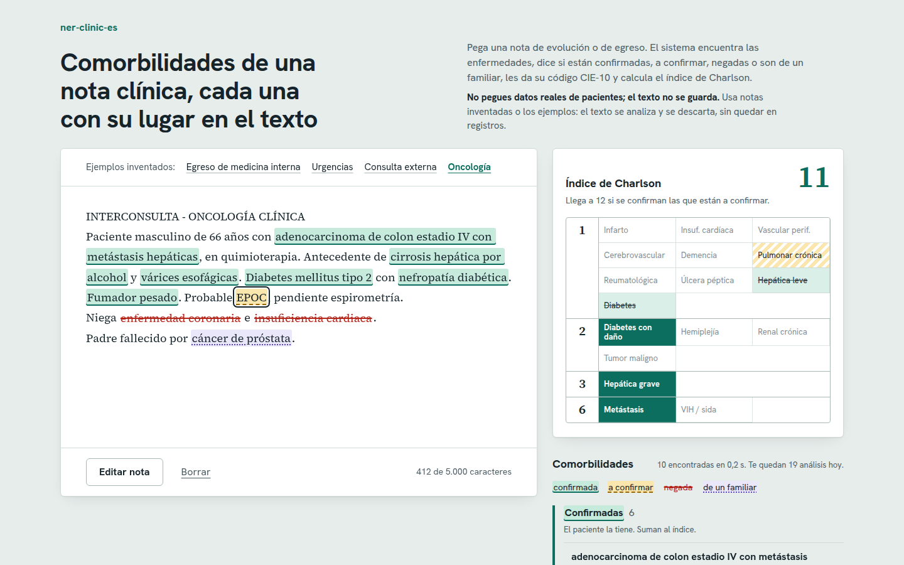
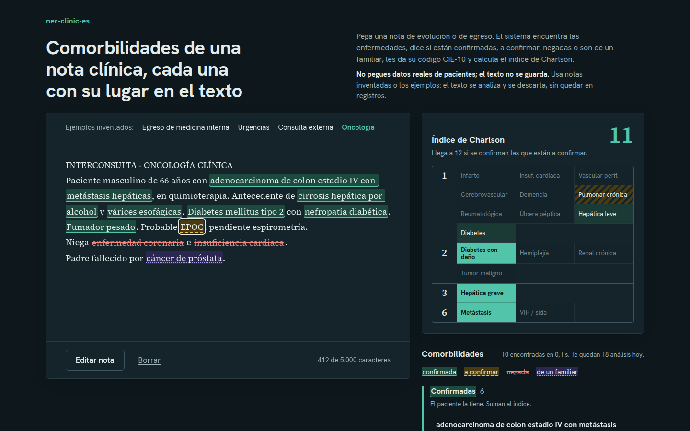
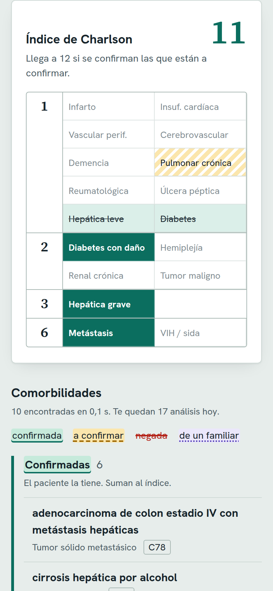

# 🩺 NER Clínico en Español

> Extracción automática de comorbilidades desde historias clínicas en español: detecta enfermedades, distingue si el paciente **las tiene, las niega, se sospechan o son antecedentes familiares**, y sugiere su código **CIE-10**.

**[Probar la demo →](https://ner-clinic-es-355389257185.us-central1.run.app)** · pega una nota (o usa un ejemplo) y mira cada comorbilidad con su estado, su código y su lugar en el texto. No pegues datos reales: la demo no guarda el texto.

https://github.com/user-attachments/assets/bbd86fa3-2890-4929-ac57-84c5497b7dde

*Video sin sonido, 1 min: el subregistro de comorbilidades, la demo con una interconsulta de oncología y las métricas.*

<details>
<summary>Capturas: escritorio, modo oscuro y celular</summary>







</details>

Las notas de los ejemplos son inventadas.

---

## El problema

Un paciente de 66 años está en quimioterapia por un cáncer de colon. En su nota, el médico escribe además que tiene cirrosis, várices esofágicas y diabetes con daño renal, y que probablemente tiene EPOC. Al egreso se codifica el cáncer; lo demás se queda en el texto.

Para los registros, ese paciente queda **más sano de lo que está**: su índice de Charlson, que estima el riesgo según las enfermedades que lo acompañan, sale en **2** con lo codificado, cuando la nota justifica **11**. *(Es la nota inventada del video.)*

No es un caso raro. La información más valiosa del paciente está en **texto libre**: notas de ingreso, evoluciones, epicrisis. Ahí aparecen las comorbilidades ("HTA en tratamiento", "niega diabetes", "madre con cáncer de mama"), pero casi nunca quedan codificadas en los campos estructurados. Y lo que no se codifica no se ve:

- **En la atención**: quien recibe al paciente no ve de un vistazo con qué enfermedades llega; para no perderse nada, tiene que leer toda la historia.
- **En el riesgo y los perfiles de morbimortalidad**: los indicadores cuentan el diagnóstico principal, y los pacientes complejos parecen sencillos.
- **En las glosas y auditorías de cuentas médicas**: la complejidad que justifica una estancia o un procedimiento no queda respaldada en el registro, y comprobarla obliga a leer historia por historia.
- **En horas de trabajo manual** de auditores y codificadores revisando textos largos y mal escritos.

## Origen: validado en un caso real

Este proyecto nace de nuestro trabajo de grado (lo hicimos entre tres) sobre **perfil de
morbimortalidad y calidad del dato clínico** en un hospital de Bogotá. Pasamos el pipeline
por **42.983 egresos reales**, con auditoría manual para medir el desempeño, y encontramos
que **el 84,9 % de los pacientes tenía al menos una comorbilidad que solo estaba en el
texto libre**, sin código en el registro.

De la tesis a esta demo, con lo que se midió, lo que se corrigió y lo que falta:
[**caso de estudio**](docs/caso-de-estudio.md).

> 🔒 Por confidencialidad, **este repositorio no contiene ningún dato real de pacientes**. Todo lo que se publica aquí usa corpus públicos y notas sintéticas.

## Qué hace

Pegas una nota clínica en español y en menos de un segundo, sin GPU:

- **Encuentra las enfermedades** que acompañan al paciente, incluidas las siglas (HTA,
  EPOC, DM2, ICC…) y las palabras mal escritas más comunes.
- **Dice el estado de cada una**: ✅ la tiene, ❌ la niega, ❓ se sospecha o 👨‍👩‍👧 es de un
  familiar. Solo lo confirmado suma al riesgo.
- **Calcula el índice de Charlson** con sus 17 categorías y muestra cuánto subiría si se
  confirman las sospechas.
- **Sugiere el código CIE-10** y, en la demo, los 5 más parecidos para que el experto
  elija.
- **Marca el posible subregistro**: si le pasas los diagnósticos ya codificados del
  egreso, señala lo que está en la nota y no en el registro.
- **Lleva cada resultado a su lugar en la nota.** Nada de listas ciegas: quien revisa ve
  el contexto antes de creerle al sistema.

### Para quién

- **Auditoría de cuentas médicas**: priorizar las historias donde lo escrito no coincide
  con lo facturado, antes de que llegue la glosa.
- **Codificación asistida**: el codificador revisa sugerencias en lugar de leer todo el
  texto.
- **Calidad del dato y epidemiología**: perfiles de morbilidad con las comorbilidades, no
  solo con el diagnóstico principal.
- **Investigación clínica**: armar cohortes de pacientes con ciertas condiciones a partir
  de texto libre.

## Qué tan bien funciona

Todo se midió con **corpus públicos anotados por terceros**, separando desde el principio
una parte que nunca se miró al ajustar el sistema:

| Qué | Con qué datos | Resultado |
|---|---|---|
| Encuentra la enfermedad y la ubica en la nota | [DisTEMIST](https://doi.org/10.5281/zenodo.7614764), 250 casos clínicos | **88 %** (F1 0,878) |
| Distingue las enfermedades negadas | [NUBes](https://github.com/Vicomtech/NUBes-negation-uncertainty-biomedical-corpus), 14.817 frases reservadas de historias reales | F1 **0,87** (con las reglas de la tesis, 0,80) |
| Distingue las sospechas | NUBes, las mismas frases reservadas | F1 **0,86** (antes no existía ese estado) |
| Índice de Charlson exacto | 100 notas sintéticas de estilo colombiano | **96 %** de las notas (86 % en la primera medición, la única ciega) |
| Código CIE-10 (la enfermedad, a 3 caracteres) | [CodiEsp](https://doi.org/10.5281/zenodo.3837305) prueba, medido una sola vez | **78 %**; está entre los 5 que se muestran en el **91 %** |
| Tiempo por nota | CPU, sin GPU | **menos de 1 segundo** |

**Cómo leer la primera fila:** cuenta como acierto encontrar la enfermedad y ubicarla en la
nota, aunque el resaltado tenga una palabra de más o de menos. Es lo que importa para el
uso. Con la medida estricta, carácter por carácter, la que se usa para compararse con la
literatura, da F1 0,734.

La tabla completa, con precisión y recall, robustez a notas mal escritas y la comparación
de reglas contra embeddings, está en [`docs/tecnico.md`](docs/tecnico.md#métricas-completas);
cómo se midió y cómo reproducirlo, en [`docs/evaluacion.md`](docs/evaluacion.md).

## Cómo funciona

```
Nota clínica (texto libre)
        │
        ▼
1. Limpieza ─────────── encabezados de folios, ruido, normalización
        │
        ▼
2. NER ──────────────── modelo transformer biomédico en español
        │                (detecta enfermedades en el texto)
        ▼
3. Contexto ─────────── ✅ confirmada   ❌ negada   ❓ posible   👨‍👩‍👧 antecedente familiar
        │
        ▼
4. Depuración ───────── quita duplicados y errores ortográficos
        │                (Jaro-Winkler / Levenshtein)
        ▼
5. Cruce ────────────── ¿la comorbilidad ya está en los diagnósticos
        │                registrados del egreso? (posible subregistro)
        ▼
6. Charlson + CIE-10 ── categoría de Charlson, código sugerido e índice
        │
        ▼
JSON / tabla lista para auditoría o análisis
```

En el paso 6, lo que las reglas no reconocen lo decide un **normalizador por embeddings**
(SapBERT) contra el catálogo CIE-10: primero las reglas, que entienden las siglas
colombianas, y de respaldo el modelo, que entiende formas de escribir que ninguna regla
previó.

### Un ejemplo

```python
from ner_clinic import analizar

nota = (
    "Paciente femenina de 67 años con antecedente de HTA y diabetes mellitus tipo 2 en "
    "manejo con metformina. Niega EPOC. Madre con cáncer de mama."
)
resultado = analizar(nota, diagnosticos_registrados=["Diabetes mellitus no insulinodependiente"])
```

**Salida real** del modelo (CPU):

| Entidad | Posición | Estado | Charlson | CIE-10 sugerido | Registrado |
|---|---|---|---|---|---|
| HTA | 48-51 | ✅ Confirmada | (fuera de Charlson) | | ❌ No: posible subregistro |
| diabetes mellitus tipo 2 | 54-78 | ✅ Confirmada | Diabetes (1 punto) | E11.9 | ✅ Sí: "Diabetes mellitus no insulinodependiente" |
| EPOC | 111-115 | ❌ Negada | (no se codifica) | | |
| cáncer de mama | 127-141 | 👨‍👩‍👧 Antecedente familiar | (no se codifica) | | |

**Índice de Charlson: 1.** Solo suman las confirmadas: la EPOC negada y el cáncer de la
madre no cuentan. La hipertensión no es una de las categorías de Charlson, así que sale
confirmada pero sin categoría ni código.

Qué trae cada resultado campo por campo, el normalizador y el cruce con los diagnósticos
registrados: [`docs/tecnico.md`](docs/tecnico.md).

## Usarlo

- **[Demo web](https://ner-clinic-es-355389257185.us-central1.run.app)**: corre en Google
  Cloud Run con topes de uso y de costo. Se apaga cuando nadie la usa, así que la primera
  visita tarda menos de un minuto en despertar el modelo; la página lo avisa.
- **Librería Python** (`ner_clinic`): `analizar(nota)` hace todo el pipeline.
- **API REST** (FastAPI), para integrarlo con otros sistemas:

  ```bash
  uv sync
  uv run python -m ner_clinic_api        # http://127.0.0.1:8000
  curl -s http://127.0.0.1:8000/api/analizar -H 'content-type: application/json' \
    -d '{"texto": "Paciente con HTA y DM2. Niega EPOC."}'
  ```

- **Docker**, para levantarlo con un solo comando.

Variables de entorno, artefactos del normalizador e imagen Docker:
[`docs/tecnico.md`](docs/tecnico.md#correr-la-api-en-local). Despliegue y costos:
[`docs/despliegue.md`](docs/despliegue.md).

## Limitaciones

Es una ayuda para leer más rápido, no un sistema para codificar o decidir solo.

- **El código CIE-10 es una sugerencia.** Se mide a 3 caracteres: acierta la enfermedad
  (E11, diabetes tipo 2), no siempre el detalle (E11.2 frente a E11.9). Por eso la demo
  muestra hasta 5 opciones para que el experto elija. Elegir otra no recalcula la
  categoría de Charlson.
- **Catálogo de España.** El código sale de la CIE-10-ES. Colombia usa la CIE-10 de la
  OMS (casi igual a 3 caracteres); para un cliente habría que pasarlo a la tabla de SISPRO.
- **Vocabulario de España.** Los corpus de evaluación (DisTEMIST, NUBes, CodiEsp) son de
  España. En notas colombianas cambian siglas y expresiones, y con formas de escribir
  nunca vistas el normalizador rinde casi igual que las reglas.
- **La negación no es perfecta.** En NUBes queda sin negar una de cada seis o siete
  enfermedades negadas. No resuelve referencias como "dicha patología" o "los diagnósticos
  anteriores".
- **No distingue el diagnóstico principal**: lista todas las enfermedades de la nota.
- **Mediciones del set sintético.** Después de la primera, ya no son ciegas: las reglas se
  corrigieron mirando sus errores. Las cifras de referencia son las de corpus públicos con
  datos reservados.

## Datos

- **Corpus públicos anotados** de texto clínico en español: DisTEMIST (CC BY 4.0), el corpus con el que se entrenó el modelo base, y NUBes (CC BY-SA 3.0 ES), de negación en historias clínicas reales.
- **Notas clínicas sintéticas** generadas para la demo.
- **Catálogo CIE-10** público.

## Licencias y atribución

| Qué | Licencia | Dónde se usa |
|---|---|---|
| Modelo NER [`BSC-NLP4BIA/bsc-bio-ehr-es-distemist`](https://huggingface.co/BSC-NLP4BIA/bsc-bio-ehr-es-distemist) | CC BY 4.0 | Pipeline y demo |
| [DisTEMIST](https://doi.org/10.5281/zenodo.7614764) | CC BY 4.0 | Entrenamiento del modelo NER (de sus autores) y evaluación |
| [NUBes](https://github.com/Vicomtech/NUBes-negation-uncertainty-biomedical-corpus) | CC BY-SA 3.0 ES | Solo evaluación de la negación y la sospecha |
| [SapBERT](https://github.com/cambridgeltl/sapbert) | MIT (entrenado con UMLS: ver [`docs/datos.md`](docs/datos.md)) | Normalizador de la demo |
| Catálogo CIE-10-ES y [CodiEsp](https://doi.org/10.5281/zenodo.3837305) | CC BY 4.0 | Índice del normalizador y evaluación |
| Fuentes Hanken Grotesk y Source Serif 4 | SIL OFL 1.1 | Front de la demo |

La demo cita el modelo, SapBERT, CodiEsp y las fuentes en su pie. Detalle de cada fuente
en [`docs/datos.md`](docs/datos.md).

## Stack

Python · Hugging Face Transformers · SapBERT · RapidFuzz · FastAPI · HTML, CSS y JavaScript sin dependencias · Docker · Google Cloud Run · Firestore

## Qué sigue

El pipeline, la evaluación, la API, la demo con despliegue automático, el video y el
[caso de estudio](docs/caso-de-estudio.md) están terminados. Lo que falta para usarlo
con un cliente:

- **Medir con notas colombianas** anotadas por expertos: los corpus de evaluación son de
  España y cambian siglas y expresiones.
- **Pasar los códigos a la CIE-10 de la OMS** que usa Colombia (tabla de SISPRO) y
  preparar la transición a la CIE-11.
- **Conectarlo a los egresos de una institución** para marcar, antes de facturar, las
  comorbilidades que están en la nota y no en el registro.

## Autor

**Diego Galindo**: científico de datos · NLP clínico · ML aplicado
